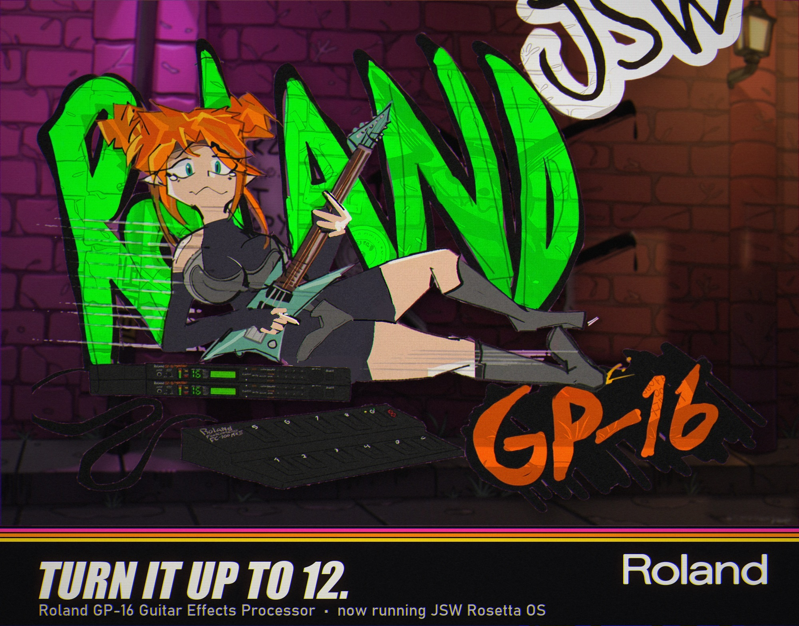

<p align="center"></p>
<p align="center"></p>

# Super GP-16 Rosetta OS (JSW ROSETTA OS v2.8 WIP)

> **Runs on real hardware.** v2.7 runs on a real Roland GP-16 from a flash chip in the IC11 socket. Since v2.4 the
> OS also reaches into the DSPs themselves: a cab sim built from custom EQ coefficients, and a hidden x2 drive stage
> that takes the dirt knobs past 10. v2.7 removes stock code nobody needs (the old Edit menu, the factory/test menus)
> and frees 24 KB of ROM for what comes next. **v2.8 (WIP, unstable testing on hardware)** adds REVERSE DLY: a real
> reverse delay with the DSP's memory borrowed to 2 s and the dry cancelled inside the DSP. It plays on the unit;
> it is not finished. See [Status](#status) and [the edges](#reverse-delay-the-edges).

A new OS for the Roland GP-16 guitar processor: the rack becomes **one pedal with real knobs**, a **pedal + amp rig**,
or a **12-slot pedalboard**, played from the front panel with no patch list in the way. It patches your own IC11 dump
(NEC V25 code) and runs on the stock DSPs, so the sound is the GP-16's own blocks, voiced like the classic pedals.

Part of the Rosetta family, after [Rosetta ROM](https://github.com/yuyoi/Rompler-RosettaRom) and the
[D-110 Rosetta OS](https://github.com/yuyoi/D110-rosetta-OS-v11).

## What it does

- **Boots as the pedal.** Power-on shows "JSW ROSETTA OS" with a flying dragon, then goes straight to the last mode
  you used (PEDAL, RIG or BOARD).
- **PEDAL mode:** pick one of 59 pedals; the GP-16 becomes that pedal.
- **RIG mode:** one pedal into one of 12 amps (amp = EQ + cab sim + comp voicing).
- **BOARD mode:** a pedal in every GP-16 block.
  - Each pedal borrows the extra blocks its voicing needs (a Tube Screamer takes the EQ, a Leslie takes the tremolo and
    a touch of the dirt block, the Space Echo takes the spring reverb) when they are free.
  - Chain-order presets, an **A/B/Y box** for the outputs, and **8 board memories**.
- **Real knobs that act like the originals.** Each knob can move several settings at once, like the real circuit:
  - Big Muff and DS-1 TONE are true tilt controls; RAT FILTER is a low-pass; Klon GAIN also raises its mid bump.
  - HM-2 LOW and HIGH boost about 100 Hz and 1.1 kHz.
  - Switches (Phase 90 script/block, Leslie slow/fast, Small Clone depth) and mode buttons (Dimension C).
- **Voiced in real units.** Every voicing is written in Hz, dB and Q from the firmware's own EQ tables. The
  fuzzes, overdrives and Funeral are level-matched.
- **Expression pedal per pedal.** The wahs sweep, the Whammy bends. On a board, the first pedal in the chain that
  wants the expression pedal gets it.
- **Pedals can bring their own chain order.** FUNERAL is the Funeralopolis path: Muff, into a parked wah, into the
  compressor acting as a cranked amp. Its VOL knob goes past real-pedal range: above about 6 it is a boost (fuzz level,
  compressor makeup gain and EQ output all rise together, all at max on 10).
- **CAB knob on every amp** (RIG and BOARD): OFF / 4X / 2X / 1X cab sims, written straight into the DSP's HI EQ band as
  a real 2nd-order low-pass (decoded from the DSP, see `re/DSP_CRACK.md`).
- **Dirt past 10.** DIST pedals go to 10+ / 11 / 11+ / 12: a hidden x2 stage in the DSP's clipper (real extra clipping,
  not just level), with the drive raised in steps on top.
- **LINE OUT FILTER knobs** get a dB law with a true OFF at 0 (stock never fully cuts a band).
- **SysEx debug port** (MIDI ch 1): DSP coefficient writes and memory read/write from a PC (`re/gp16poke.py`).

### Pedals (60) and amps (12)

| Slot | Pedals |
|---|---|
| A1 COMP | DYNA COMP, CS-3 COMP, ROSS COMP, OR SQUEEZER |
| A2 DIRT | TUBE SCREAMER, RAT, DS-1, BIG MUFF, METAL ZONE, SD-1, KLON, FUZZ FACE, METAL MUFF, FUNERAL, IRON MAN, HM-2, RANGEMASTER, OD-1, FUZZ FACTORY, OCTAVIA, RAM'S HEAD, GREEN RUSSIAN, DETROIT, FLOOD 1, FLOOD 2, HOLYWAR |
| A3 WAH/FILTER | TOUCH WAH, CRYBABY WAH, RESO WAH |
| A4 PHASER | SLICER, PHASE 90 |
| A5 EQ | GE-7 EQ |
| A6 GATE | NS-2 GATE |
| B1 SHORT DELAY | DOUBLER, SLAPBACK |
| B2 MOD | PITCH/OCTAVE, CHORUS CE-2, DIMENSION D, FLANGER, LESLIE, ELEC MISTRESS, CE-1, WHAMMY, SMALL CLONE, DIMENSION C |
| B3 TREM/PAN | AUTOPAN, TREMOLO |
| B4 DELAY | DIGITAL DLY, SPACE ECHO, MEMORY MAN |
| B5 REVERB | SPRING, HALL/PLATE, SHIMMER, CATHEDRAL, CAVE, CHURCH, STAGE, AMBIENT, SHOEGAZE WASH |
| B6 AMP/CAB | CLEAN, TWIN, JCM800, AC30, DOOM, DI / FLAT, RADIO, JC-120, 5150, SUPER LEAD, RANDALL, JCM800 RIP |

**REVERSE DLY** (v2.8 WIP, PEDAL and RIG mode, not on the board): a reverse delay locked to tempo. Knobs: **BP** BPM
40-240, **NT** note value (16, 8T, 8, 4T, 8., 4, 4., 2; auto-halved past the 1 s memory), **MX** dry 0-10 (10 = 100%
wet), **F** feedback, **T** tone (input cut ~2-8 kHz), **L** level. Under the hood: chip 2's other memory writes are
silenced so the tap gets 2 s of line, a CPU engine on timer 0 moves the tap backwards every 2 DSP frames, and the
dry is cancelled with a -1.0 coefficient (`re/rev_blob.asm`, research in `re/DSP_CRACK.md`). Any sound change stops
the engine and restores the stock DSP program first.

### REVERSE DLY: the edges

This runs on real hardware and sounds like a reverse delay, but it lives at the edge of what a 1989 rack DSP and an
8 MHz CPU were built to do, and the rough edges are real:

- **It is a CPU trick, not a native effect.** The GP-16's DSP has no reverse mode. The CPU walks the delay tap
  backwards one step every two DSP frames (~16 kHz) from a timer interrupt. That rate is the hard ceiling, and it is
  where the **digital crackle** comes from: reversing at half sample rate folds a mirror image in at 16 kHz minus the
  note, loudest on high notes and at high volume. Lowering the input tone and the level tames it; a low-pass placed
  *after* the delay would mostly kill it, and is not built yet.
- **The CPU and the DSP share one set of latches.** If the engine's write and the OS's own DSP write overlap, the
  interface jams and the unit hangs. The engine now stands down for the whole time the menu is doing anything, which
  fixed the hang on select/exit, but this is the single most fragile part and the reason this is **unstable testing,
  not a release**. Writing DSP levels from inside the engine interrupt hangs it outright and scrambles battery RAM;
  that path is walled off.
- **Memory is ~2 s.** Borrowing the rest of the delay chip's RAM gets 2.05 s; the DRAM clock sets that wall. Long
  chunks auto-halve to fit, so very slow tempos shorten the reversed grain.
- **Still open:** click-free chunk edges (fades must never touch the DSP from the engine interrupt), the post-delay
  low-pass for the crackle, octave-up/down reverse speeds, and a BOARD slot. Progress and the full DSP reverse-
  engineering log are in [`re/DSP_CRACK.md`](re/DSP_CRACK.md).

If you burn it: keep your v2.7 image, and if the unit ever hangs, power-cycle. A hang can corrupt battery RAM
(patches, settings); `re/ramrestore.py` puts it back from a clean dump.

Two voicings are custom: FUNERAL (doom fuzz) and IRON MAN (an early-Iommi voicing). RADIO is a transistor-radio
amp.

**Signature tones**, each a pedal with a matching RIG amp. In RIG mode the amp's EQ replaces the pedal's, so the amp
carries the player's EQ and cab:

| Pedal | Tone | RIG amp |
|---|---|---|
| DETROIT | Ace Frehley, *Detroit Rock City* solo | SUPER LEAD |
| FLOOD 1 | Dimebag rhythm | RANDALL |
| FLOOD 2 | Dimebag, *Floods* outro solo | RANDALL |
| HOLYWAR | Dave Mustaine, *Holy Wars* | JCM800 RIP |

The voicings are recipes in `re/pedals.py`, and the knobs are in `re/gen_pedal_data.py`. Knob list per pedal:
[`PEDAL_MODES.md`](PEDAL_MODES.md).

## GP Tone Zone (PC app)

[`tonezone/`](tonezone/README.md) turns tone captures that already exist (NAM `.nam` files, cab IR `.wav` files)
into GP-16 sounds. It doesn't make neural captures of its own.

1. It plays a calibrated guitar through the capture (in dBu, the capture's own scale) and measures the clipping
   type, the gain curve and the voicing.
2. It fits the GP-16's dirt type, drive, level and 4-band EQ, using the EQ's real DSP response (checked against cab
   sims measured on the unit).
3. **REFINE on the unit:** with the GP-16 in an audio loop (interface out -> GP-16 in, GP-16 out -> interface in, MIDI
   both ways) it plays the same test through the real unit, locks the drive to the capture's clipping curve, then
   corrects EQ and level in measured passes.
4. You audition the result over MIDI, save it to a library, or add it to the OS build as a pedal or RIG amp.

Its look follows Rosetta ROM Studio, in the GP-16's own colours.

## Controls

| Where | Key | Does |
|---|---|---|
| anywhere in play | **SYSTEM** or **EDIT** | split screen `UP:PEDAL DN:RIG / EDIT:BOARD` |
| split screen | FUNCTION up / down / **EDIT** | PEDAL / RIG / BOARD mode |
| split screen | SYSTEM again | the stock System menu (all stock settings kept) |
| any mode | **ESC** | back to the split screen; ESC again = stock patch screen |
| knob screen (1-4 knobs) | buttons **1-4** / **5-8** | knob 1-4 up / down (one column per knob: 1 and 5, 2 and 6...) |
| knob screen (5-6 knobs) | **1-6** / **7**, **8** | pick a knob in a row (underline cursor) / previous, next knob |
| knob screen | dial or BANK / GROUP | moves the knob touched last (marked `*`, or the underline cursor) |
| amps | **CB** knob | cab sim OFF / 4X / 2X / 1X |
| DIST pedals | GAIN knob past 10 | 10+ / 11 / 11+ / 12 (hidden x2 stage) |
| Dimension C | **1-4** | pick a mode; the lit one again = off |
| PEDAL | FUNCTION | knobs <-> pick pedal |
| RIG | FUNCTION up / down | up = the pedal, down = the amp; the same side again = pick <-> knobs |
| pick pages | dial or BANK / GROUP | previous / next pedal or amp |
| BOARD | FUNCTION | next / previous page: slots A1 COMP ... B6 AMP, then ORDER, OUT, BOARD MEMORY |
| BOARD slot | BANK / GROUP | previous / next pedal for that slot (OUT = empty) |
| BOARD slot | buttons + dial | that pedal's knobs |
| BOARD ORDER | 1 / 5 | A chain: WAH>DIRT, DIRT>WAH, PHASE>DIRT, DIRT>WAH>COMP |
| BOARD ORDER | 2 / 6 | B chain: STOCK, TREM LAST, REV>DELAY |
| BOARD OUT | 1 / 5 | A/B/Y box: AMP 1 (CH1), AMP 2 (CH2), BOTH |
| any BOARD page | **WRITE**, then **1-8** | save the board to memory 1-8 (ESC = cancel) |
| BOARD MEMORY | **1-8** | load that board (`-` = empty, `>` = last loaded/saved) |

A slot whose block is borrowed shows `<NAME>` of the pedal using it and refuses a new pedal until that pedal changes.
The gate stays last in chain A and the amp/cab last in chain B (the GP-16 fixes those positions). Knob positions are
remembered per pedal and amp in battery RAM. A board memory keeps its pedals, order, outputs and knob positions.

## Build and burn

You must supply your **own IC11 dump**. It is Roland's copyrighted code and is not in this repo. The tools refuse
anything other than the "Super GP Ver 1.0" ROM (MD5 `ac5f56bcb3d8c30ddf3f1ffe88b13556`).

1. **Read IC11** (128 KB, 32-pin DIP mask ROM) on a programmer such as a T48 and keep the original chip:
   ```
   minipro -p AM27C010@DIP32 -y -r ic11.bin
   ```
2. **Build** (Python 3.11, `pip install capstone`, [NASM](https://www.nasm.us/) 2.16):
   ```
   cd re
   py -3.11 build_all.py ../ic11.bin
   ```
   This writes `re/build/gp16_mod_v2_8.bin` (128 KB) and `re/build/gp16_mod_v2_8_sst512k.bin` (the same image 4x).
3. **Burn** the `_sst512k` file to a 512 KB flash (SST39SF040, or AMIC A29040 for chips that ID as `0x3786`), read it
   back and compare:
   ```
   minipro -p SST39SF040 -w gp16_mod_v2_8_sst512k.bin
   ```
4. **Fit it in IC11** (notch the same way). The GP-16 board already ties pin 31 high, so the flash drops straight in:
   no wires, no cuts. Put the original chip back any time.

- **No factory reset on the unit any more:** v2.7 removes the stock power-on menus (factory preset load, system
  data init, test mode, demos, credits) and the stock Edit menu. Your patches and settings stay as they are; MIDI,
  SysEx (bulk dump / data load) and the stock System menu are untouched.
- **Settings across versions:** knob positions and board memories reset only when the pedal list or the number of
  knobs changes; voicing and knob retunes keep them.
- Please don't share patched `.bin` files: share this repo.

### Test in emulation first (optional)

`pip install unicorn capstone`. Each script runs the whole firmware, boots to the main loop and plays a scripted
front-panel session:
```
py -3.11 -I emu_v10.py build/gp16_mod_v2_8.bin    # macros, 6-knob screen, switches, Dim C, exp pedal, rig, cab, x2 stage, board memories
py -3.11 -I emu_v09.py build/gp16_mod_v2_8.bin    # board mode: grabs, order, A/B/Y
py -3.11 -I emu_v11.py build/gp16_mod_v2_8.bin    # v2.7: tripwire on every removed byte, real System menu walk, EDIT key
py -3.11 -I emu_v28.py build/gp16_mod_v2_8.bin    # v2.8: REVERSE DLY screen, DSP setup, engine start/stop, restores
py -3.11 -I emu_boot_banner.py build/gp16_mod_v2_8.bin   # boot screen text
```
The test scripts print `PASS`. `emu_v10.py` also checks that nothing but the OS writes to its battery-RAM areas;
`emu_v11.py` fails if the firmware ever runs a byte that v2.7 removed.

## Files

| File | |
|---|---|
| `re/build_all.py` | one-shot build from your dump |
| `re/build_mod.py` | applies every patch (each checks the original bytes first) and places the new code |
| `re/pedal_menu.asm` | the PEDAL / RIG / BOARD OS (NASM, x86-16, runs at ROM 0x0200) |
| `re/far_blob.asm` | overflow routines (dial scaling, x2 stage, cab writer + tables) at ROM 0x1FD90, called far |
| `re/reach.py`, `re/dead_ranges.txt` | call graph of the stock firmware: what v2.7 removes and why it is safe |
| `re/pedals.py` | pedal and amp voicings in real units (Hz, dB, Q, ms), plus the level trims |
| `re/gen_pedal_data.py` | knobs (macros, tables, switches), board slots, recipe -> internal-buffer mapping -> `pedal_data.inc` |
| `re/level_match.py` | loudness estimate per dirt pedal, used for the level trims |
| `re/dragon_boot.asm`, `re/dragon_vec.py`, `re/dragon_frames.bin` | boot dragon routine and art |
| `re/backdoor.py`, `re/gp16poke.py` | SysEx debug port (ROM side + PC tool, py -3.10 + mido) |
| `re/emu_v11.py`, `re/emu_v10.py`, `re/emu_v09.py`, `re/emu_v08.py`, `re/emu_menu.py`, `re/emu_boot_banner.py` | full-firmware emulation tests (unicorn) |
| `re/gp16dis.py`, `re/entries.py`, `re/coefmap.py`, `re/instrmap.py` | V25 disassembler and DSP-write analysis |
| `re/DSP_CRACK.md` | the TC23SC260 DSPs so far: bus latches and commits, 32 kHz, coefficient format, delay addressing, the 4-band EQ maths, drive stages |
| `re/loop_rig.py`, `re/dspscan.py`, `re/dspx.py`, `re/harm.py`, `re/ir2.py`, `re/eqtest.py`, `re/delaytest.py` | audio-loop measurements on the real unit (any WASAPI interface) |
| `re/dsptwin.py`, `re/emu_tick.py`, `re/ramdump.py`, `re/dsplive.py`, `re/dspreplay.py`, `re/dspstate*.py`, `re/statepush.py`, `re/coefsweep.py`, `re/cabband.py` | DSP digital twin (emulated firmware + the unit's RAM), live pokes with exact restore, coefficient sweeps, cab design |
| `re/dsprig.py` | earlier audio measurement rig |
| `re/GP16_RE.md` | ROM map, CPU/DSP memory map, parameter and frequency tables, key map, LCD, how each mod hooks in |
| `tonezone/` | **GP Tone Zone**: the PC app that turns NAM captures and IRs into GP-16 sounds (see its README) |
| `PC_TONE_APP.md` | plan: PC loader, USER pedal slots, translating existing tone formats into GP-16 settings |
| `PEDAL_MODES.md`, `GP16_NOTES.md`, `FILTER_REBUILD_IDEAS.md`, `re/OS_DESIGN_v04.md` | design notes |

Disassembling your dump: `py -3.11 -I gp16dis.py ../dumps/gp16_u1_ic11.bin out` writes `re/out/listing.asm`. The
listing is derived from Roland's code: keep it private.

## Status

| Ver | | Hardware |
|---|---|---|
| 0.1 | boot banner + LINE OUT FILTER dB knob law | works |
| 0.2 | SysEx debug port: live DSP coefficient writes | works |
| 0.3 | 16 factory presets kept, frees 12.7 KB for new code | works |
| 0.4 | debug port: memory read/write | built |
| 0.5 | boot dragon | works |
| 0.6 | first PEDAL/RIG menu | failed (wrong key, wrong buffer map), replaced by 0.7 |
| 0.7 | PEDAL/RIG through the firmware's own setters | burned |
| 0.8 | rack as one pedal: real knobs, boots into the pedal | works |
| 0.9 | BOARD mode, 9 new pedals, A/B/Y box | folded into 1.0 |
| 1.0 | JSW ROSETTA OS v1: macro knobs, 6-knob screen, board memories, exp pedal per pedal, 16 new sounds, 1 factory preset | works |
| 2.0 | every voicing redone from the original circuits in real units (Hz / dB / Q) | works |
| 2.1 | level match: Funeral and the overdrives brought up to the fuzzes; settings survive voicing tweaks | works |
| 2.2 | Funeral VOL = boost knob (way louder past 6) | works |
| 2.3 | signature pedals + RIG amps (DETROIT, FLOOD 1/2, HOLYWAR; SUPER LEAD, RANDALL, JCM800 RIP), GP Tone Zone | works, final non-DSP beta |
| 2.4 | CAB knob on the amps (cab sims from custom DSP EQ coefficients); RIG and knob-pick buttons follow the screen | works |
| 2.5 | dirt past 10: 11 / 12 via the DSP's hidden x2 stage; the dial scaled for the smooth (no-detent) encoder | works |
| 2.6 | far blob at the end of ROM; finer steps 10+ / 11 / 11+ / 12 | works |
| 2.7 | stock Edit menu and power-on factory/test/demo menus removed (call-graph checked), 24 KB freed; EDIT = split | works (boot, SysEx, menus) |
| 2.8 | WIP: REVERSE DLY pedal (2 s borrowed memory, 100% wet, BPM + note sync) | **plays on hardware, unstable testing**: works, residual digital crackle at volume, edges still open |

On one unit the LCD contrast used to come up low on about 1 in 5 boots. The OS re-sends the contrast setting at the
end of boot, which fixed it there.

## TODO

- [ ] Hardware test of board mode and board memories.
- [ ] Tune every voicing by ear into a real amp.
- [ ] USER 1-8 pedal slots in battery RAM (load new pedals over MIDI, no burn). Plan: `PC_TONE_APP.md`.
- [x] GP Tone Zone: refine each sound on the unit itself through an audio loop.
- [ ] GP Tone Zone: run it on real TONE3000 captures; set the x2 stage over SysEx; preset formats (Helix, BOSS).
- [ ] Use the 24 KB freed in v2.7: delay toys (REVERSE DLY started in v2.8), a SYNTH pedal (hot fuzz + envelope
  filter + sub octave).
- [ ] REVERSE DLY: burn + ear test, click-free chunk edges, a low-pass after the delay for the 16 kHz - f mirror,
  octave up/down speeds, BOARD slot.
- [ ] Hold-to-repeat on the knob buttons.
- [ ] Crack the rest of the TC23SC260 instruction set (EQ, cab, delay taps and the drive stages are done): new
  algorithms, an OD -> DIST cascade.

## Credits and legal

- **Made by JunkSmithWizard (JSW) together with Claude (Anthropic's AI).**
- Roland, BOSS and GP-16 are trademarks of Roland Corporation. This project is not affiliated with Roland. No ROM data
  is distributed here: you read your own chip and the tools add the new bytes to your dump.
- Pedal and amp names describe the sound each voicing aims for. They are trademarks of their owners; these are GP-16
  block settings, not models of those circuits.
- MIT licensed (see `LICENSE`).
